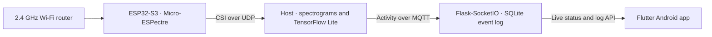

# Geist

**A privacy-first home monitoring prototype using Wi-Fi sensing.** April 2026 final-year project, Agni College of Technology.

Geist uses an ESP32-S3 to measure how movement changes Wi-Fi Channel State Information (CSI). A computer on the same network classifies the signal as **idle, walking, sitting, or a possible fall**. The Flutter dashboard shows the current activity, raises a local Android alert when it receives a fall prediction, and displays an event history. Sensing uses no cameras, microphones, or wearables.

## See Geist in action

| Walking                                                                                                                                     | Seated                                                                                                                               | Fall alert                                                                                                                                                     |
| ------------------------------------------------------------------------------------------------------------------------------------------- | ------------------------------------------------------------------------------------------------------------------------------------ | -------------------------------------------------------------------------------------------------------------------------------------------------------------- |
|  |  |  |

- **Room demonstration** (46 seconds) shows the dashboard alongside staged walking, sitting, and fall activity. [Watch the project demo (MP4)](screenshots%20and%20captures/project_demo.mp4)
- **Android walkthrough** (73 seconds) shows live status, Event History, and the experimental recording and retraining flow in **Teach Geist**. [Watch the app walkthrough (MP4)](screenshots%20and%20captures/app_demo_walkthrough.mp4)

## Try it

| What you want to do                                              | Start here                                                                              |
| ---------------------------------------------------------------- | --------------------------------------------------------------------------------------- |
| See the dashboard and event log on an Android device or emulator | [Run the scripted demo without an ESP32](docs/setup.md#demo-without-an-esp32)           |
| Classify activity from Wi-Fi in a room                           | [Connect an ESP32-S3 and run live sensing](docs/setup.md#live-sensing-with-an-esp32-s3) |
| Set the bridge address, view events, or open Teach Geist         | [Use the Flutter dashboard](app/README.md)                                              |
| Inspect the feature pipeline or train with your own recordings   | [Activity recognition and training](docs/activity-recognition.md)                       |

## How it works

1. **Capture.** The ESP32-S3 joins a 2.4 GHz Wi-Fi network and sends CSI packets to the host over UDP. CSI describes how the radio channel affects the received signal across multiple subcarriers. Movement in the room can change that pattern over time.
2. **Classify.** The host turns a rolling window of amplitudes into a spectrogram, runs a TensorFlow Lite convolutional neural network, and smooths predictions across recent windows.
3. **Report.** The host publishes activity over MQTT. The Flask-SocketIO bridge forwards it to the dashboard and records fall messages in SQLite for the Logs screen.

[Micro-ESPectre v2.6.0](https://github.com/francescopace/espectre/releases/tag/2.6.0), by Francesco Pace and ESPectre contributors, provides the CSI capture, streaming, and device tooling. Geist adds the host classifier, bridge, event history, and Flutter dashboard.

Geist is a research prototype for a trusted local network. Radio conditions, device placement, and training data affect predictions. Use Geist for demonstrations and experiments, and rely on established emergency systems for safety-critical monitoring.

## Project development

The original architecture illustration shows the project's five stages and depicts an ESP32-C3 beacon in the hardware design. The repository's live-sensing instructions use an ESP32-S3 on a 2.4 GHz access point, with inference running on the host as shown in the flowchart above. [See the prototype enclosure](docs/setup.md#prototype-hardware).

The project timeline traces how the team went from capturing and labeling CSI to training the classifier and integrating the app, then building the enclosure and testing the system. [Read the April 2026 review summary](docs/activity-recognition.md#april-2026-final-review).

## Repository map

| Path                                                         | Contents                                                          |
| ------------------------------------------------------------ | ----------------------------------------------------------------- |
| [`app/`](app/)                                               | Flutter dashboard and Android demo                                |
| [`backend/`](backend/)                                       | Flask-SocketIO bridge, local Mosquitto config, and demo publisher |
| [`src/`](src/) and [`me`](me)                                | Micro-ESPectre device code, host inference, and the device CLI    |
| [`tools/`](tools/) and [`models/`](models/)                  | CSI analysis, spectrogram generation, training, and model assets  |
| [`data/`](data/)                                             | CSI recording formats and generated files                         |
| [`docs/`](docs/)                                             | Geist setup and model guides, plus upstream references            |
| [`screenshots and captures/`](screenshots%20and%20captures/) | Dashboard captures, hardware photos, diagrams, and demos          |
| [`tests/`](tests/)                                           | Python tests for the inherited motion-sensing stack               |
| [`web/`](web/)                                               | ESPectre browser monitor and theremin                             |

## Credits and license

Geist was developed by **Tarun M**, **Ragavi P**, and  **Samuel KC**, under the supervision of **Veni G** in the Department of Computer Science and Engineering at Agni College of Technology.

The inherited Micro-ESPectre code and its modifications carry the GNU GPL v3. See the [attribution and license scope](NOTICE.md) and the [full GPL v3 text](LICENSE).
